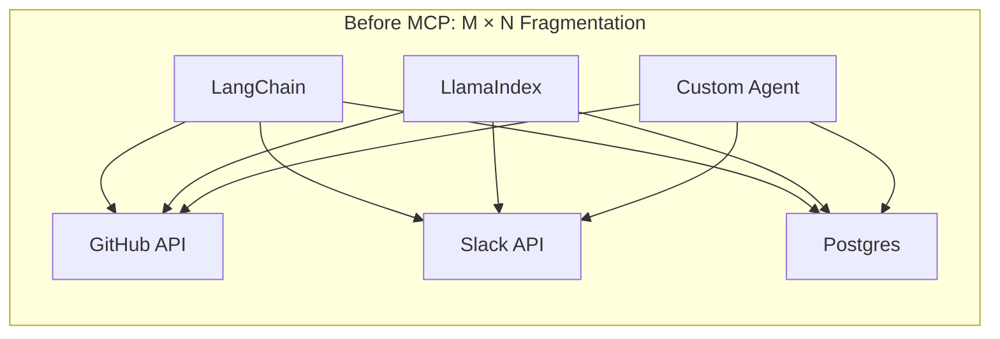
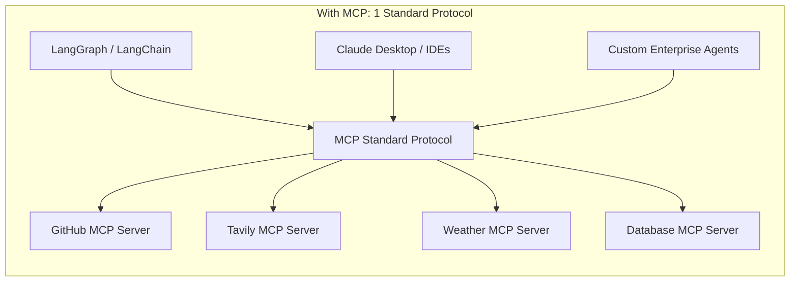
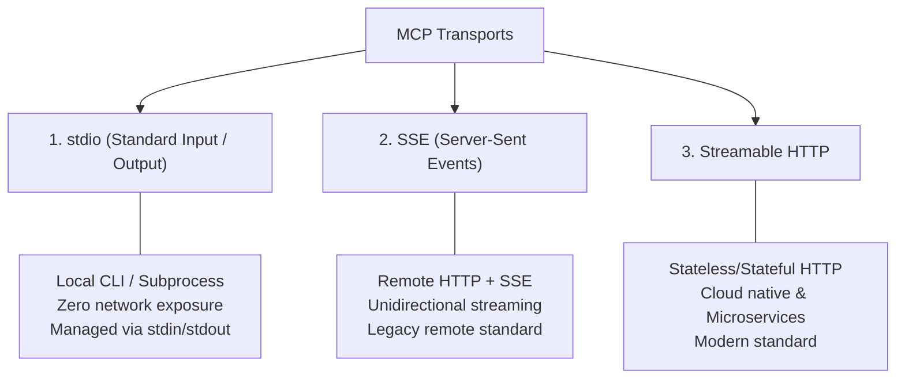
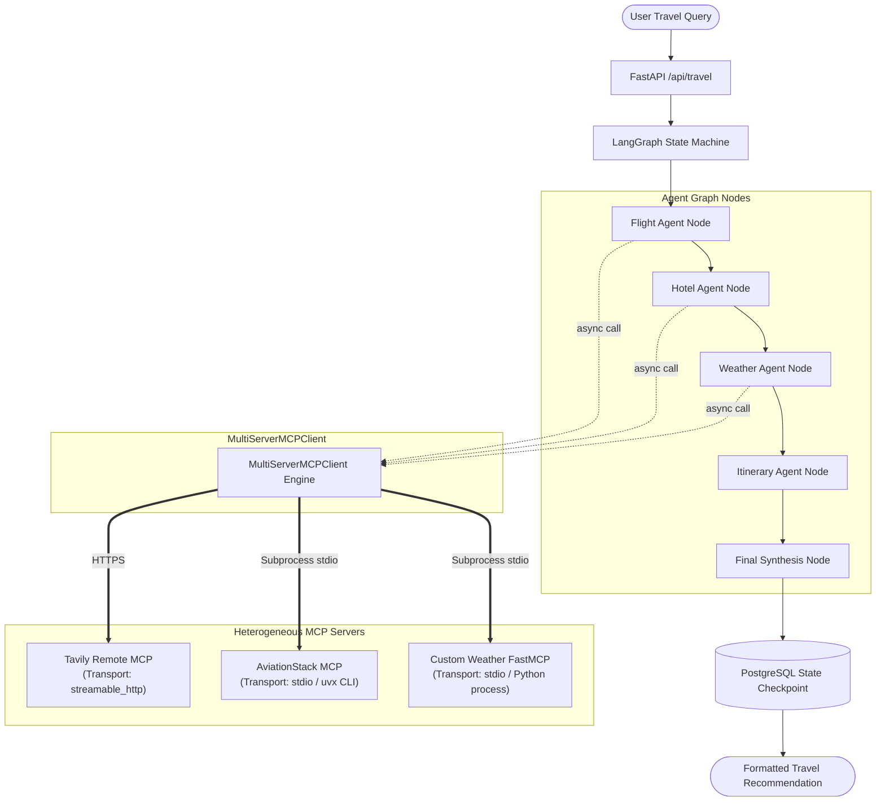

# Model Context Protocol (MCP): The Complete Production Engineering Guide

---

## 1. What is the Model Context Protocol (MCP)?

The **Model Context Protocol (MCP)** is an open standard introduced by Anthropic that standardizes how Large Language Models (LLMs) and AI agents interact with external tools, APIs, enterprise databases, and context repositories.

### The Problem MCP Solves: The $M \times N$ Integration Trap
Before MCP, integrating $M$ different AI models/frameworks (LangChain, LlamaIndex, AutoGen, CrewAI, Claude Desktop) with $N$ different data sources or tools (GitHub, Slack, PostgreSQL, custom APIs) required building custom tool adapters for every single combination:



MCP standardizes this into an open client-server protocol, identical to what the **Language Server Protocol (LSP)** did for code editors and programming languages:



### Core Primitives of MCP

| Primitive | Role | Example |
| :--- | :--- | :--- |
| **Tools** | Executable actions that models can invoke with arguments to perform operations or query dynamic data. | `tavily_search(query)`, `get_current_weather(city)` |
| **Resources** | Static or dynamic context files, database schemas, or logs that the agent can read. | `file:///app/config.json`, `postgres://schema/users` |
| **Prompts** | Pre-engineered prompt templates with parameterized slots provided directly by the server. | `debug_flight_schedule(flight_id)` |

---

## 2. Kinds of MCP Transports

MCP operates over JSON-RPC 2.0 messages. The communication channel is decoupled from the business logic through three primary transport mechanisms:



### 1. `stdio` (Standard Input / Output)
* **How it works**: The host application launches the MCP server as a child subprocess using `sys.executable`, `node`, `docker`, or `uvx`. Messages flow through `stdin` and `stdout`.
* **When to use**:
  * Local agent execution (desktop apps, developer machines).
  * Private CLI utilities (e.g., executing local system commands, database queries from private networks).
  * Standalone Python scripts where the server runs on the same machine.
* **Pros**: No port binding needed, no network exposure, inherently sandboxed to the local host's permissions.
* **Cons**: Host process must manage subprocess lifecycles, memory, and zombie process cleanup.

### 2. `SSE` (Server-Sent Events)
* **How it works**: HTTP POST for requests from client to server, with long-lived HTTP SSE connection for receiving server events.
* **When to use**: Cloud-hosted servers where tools need to push asynchronous progress or notifications back to the client.

### 3. `streamable_http` / Remote HTTP
* **How it works**: Modern web-based transport where client sends requests via standard HTTP POST and receives streamed JSON responses.
* **When to use**: Production microservices, third-party hosted MCP providers (e.g., Tavily Remote MCP), serverless deployments (Kubernetes, AWS ECS, Cloud Run).
* **Pros**: Scales horizontally with load balancers, works across Kubernetes pods, standard observability via API gateways.

---

## 3. Production Architecture Patterns

### Architecture 1: Multi-Agent Orchestration with Centralized Multi-Server Client
This pattern (used in our application) connects multiple specialized agents in a directed graph (LangGraph) with a shared MCP Client managing connections across diverse transports:



---

### Architecture 2: Enterprise Production MCP Gateway Pattern
For production enterprise environments with high traffic, multiple teams, and compliance requirements, agents should never directly spawn raw subprocesses. Instead, use an **MCP Gateway**:

```mermaid
flowchart LR
    subgraph AgentFleet["Agent Workloads"]
        A1[Agent Service A]
        A2[Agent Service B]
        A3[Customer Facing Bot]
    end

    subgraph Gateway["Enterprise MCP Gateway / Proxy"]
        GW[API Gateway / Envoy]
        Auth[Auth & Token Verification]
        RateLimit[Token & Rate Limiter]
        CircuitBreaker[Circuit Breaker & Fallbacks]
        Audit[Audit & Trace Logger]
    end

    subgraph CloudMCPServices["MCP Internal Services (K8s / Serverless)"]
        M1[Weather MCP Service]
        M2[CRM MCP Service]
        M3[Billing MCP Service]
        M4[Database MCP Service]
    end

    AgentFleet --> GW
    GW --> Auth --> RateLimit --> CircuitBreaker --> Audit
    Audit --> CloudMCPServices
```



---

## 4. Production Engineering Best Practices

### 1. Guarding Against LLM Rate Limits (Token Budgets & Pruning)
* **Problem**: Raw tool outputs (e.g. web search scrapes or database dumps) can easily dump 10,000+ tokens into the prompt context, triggering **HTTP 413 Rate Limit (TPM exceeded)** errors.
* **Production Rule**: Always filter, sanitize, and truncate tool payloads before passing them to the next agent or synthesis step:
  ```python
  # Safe truncation pattern
  sanitized_hotel_info = str(raw_search_results)[:2500]
  ```

### 2. Subprocess Lifecycle Management in `stdio`
* Always use explicit timeouts on stdio calls.
* Ensure child processes terminate when the parent worker restarts.
* When running on Windows, use `sys.executable` for Python scripts and append `.exe` to binary commands (`uvx.exe`).

### 3. Exception Unwrapping (`ExceptionGroup`)
* Python 3.11+ wraps async TaskGroup failures in an `ExceptionGroup`. 
* Calling `str(e)` on an `ExceptionGroup` only displays `"unhandled errors in a TaskGroup (1 sub-exception)"`, concealing the underlying issue.
* Always unwrap or log full tracebacks using `traceback.print_exc()` or `traceback.format_exception(e)`.

### 4. Circuit Breakers & Fallback Mechanisms
* In multi-agent graphs, an external MCP failure must **never crash the workflow**.
* Wrap every agent node in a `try...except` block and populate the state with descriptive fallback strings (e.g., `"Live weather temporarily unavailable: ..."`).

---

## 5. What We Built & Solved in This Project

### 1. Architectural Highlights
In this workspace, we engineered an end-to-end Multi-Agent Travel Planner powered by **LangGraph**, **Groq LLM**, **PostgreSQL Checkpointing**, and a **Multi-Server MCP Architecture**:

| Server | Transport | Implementation | Purpose |
| :--- | :--- | :--- | :--- |
| **`tavily`** | `streamable_http` | Remote SaaS MCP (`https://mcp.tavily.com/mcp/`) | Live web research & hotel searches |
| **`aviationstack`** | `stdio` | Official CLI tool launched via `uvx` | Airport, airline, and flight tracking |
| **`weather`** | `stdio` | In-house Python `FastMCP` (`custom_weather_mcp.py`) | Real-time OpenWeather current & 5-slot forecasts |

---

### 2. Key Engineering Problems Solved

#### Problem 1: Local Directory Shadowing the Official `mcp` Library
* **Issue**: The local folder was initially named `mcp/`. When creating an `__init__.py`, Python resolved `import mcp` to the local directory instead of the installed PyPI package (`mcp==1.28.1`), breaking `from mcp import ClientSession`.
* **Fix**: Renamed the local folder to `mymcp/`, cleanly separating custom client code from the official SDK.

#### Problem 2: TaskGroup Exception Masking
* **Issue**: Stdio crashes outputted `unhandled errors in a TaskGroup (1 sub-exception)` without displaying the real cause.
* **Root Cause Found**: `WEATHER_SERVER_PATH` pointed to `custom_weather_mcp_server.py` while the actual file was `custom_weather_mcp.py`.
* **Fix**: Pointed `WEATHER_SERVER_PATH` to the correct file and added `traceback` printing.

#### Problem 3: Unhandled JSON Structure in `custom_weather_mcp.py`
* **Issue**: `get_forecast` called `data["list"][:5]` directly without verifying `response.status_code == 200`. Any API error or city lookup failure caused a fatal `KeyError: 'list'`.
* **Fix**: Added `if response.status_code != 200: return data` and used safe dictionary access `data.get("list", [])`.

#### Problem 4: Groq HTTP 413 Rate Limit (TPM Exceeded)
* **Issue**: Accumulated tool data across flights, raw Tavily web scrapes, weather, and full itinerary caused the prompt to reach **10,021 tokens**, exceeding Groq's 8,000 Tokens-Per-Minute (TPM) limit.
* **Fix**: Added intelligent string slicing to truncate verbose raw search outputs (`[:2500]` for hotels, `[:2000]` for flights, `[:1500]` for weather), slashing total prompt tokens down to ~2,200 tokens.

#### Problem 5: Full Observability Across All Graph Nodes
* **Improvement**: Added standardized console diagnostic logging to every agent node (`flight_agent`, `hotel_agent`, `weather_agent`, `itinerary_agent`, `final_agent`), allowing immediate visibility into real-time tool calls and execution statuses.
